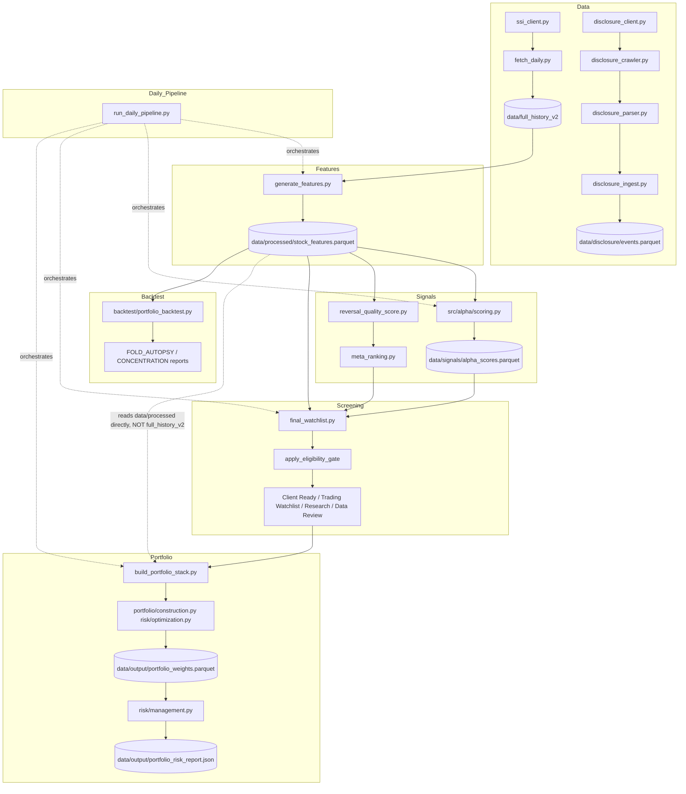

# Architecture and Dependency Map — Phase A/B

Repo root: `vietnam-quant-research` (audited at
`.claude/worktrees/charming-bartik-d21dc1`, HEAD `01d4079`). A nested
project `stock-decision-engine/` exists at repo root and was **treated as
read-only/protected per instruction** — its `src/`, `notebooks/`, and
`outputs/` were not inspected in depth and are out of scope for this
audit; confirmed untouched (see `audit_summary.json`).

## Repository structure (excluding data/, caches, venv)

```
vietnam-quant-research/
├── src/                    # reusable modules (see module map below)
├── scripts/                # CLI entrypoints, orchestrated by run_daily_pipeline.py
├── tests/                  # 32 files, 235 tests
├── notebooks/               # 19 active notebooks, organized 00_archive .. 05_client_report
├── config/                  # centralized YAML/CSV config
├── data/                    # not audited for content here (see DATA_BASELINE.md/DISCLOSURE_BASELINE.md)
├── reports/, research_notes/ # generated artifacts (figures, tables, per-symbol notes)
├── scratch/                 # one-off diagnostic scripts, not production code
├── stock-decision-engine/   # PROTECTED — nested project, not audited
└── *.md                     # ~25 standing design/audit/report documents (see below)
```

## Prior-report inventory (read as authoritative evidence, per instruction)

| Report | Covers |
|---|---|
| `DATA_BASELINE.md` | price dataset (`data/full_history_v2`) identity, verification, caveats |
| `BACKFILL_DESIGN_REPORT.md` | price backfill design, raw/adjusted-close bug (5 rounds) |
| `DATA_AUDIT_REPORT.md` | original universe-coverage-gap discovery |
| `ROBUST_FACTOR_IC_REPORT.md` | Newey-West HAC IC methodology, 44-factor retest |
| `EVENT_DETECTION_REPORT.md` | tail-event/lift framework (separate from IC testing) |
| `FACTOR_RETEST_V2_REPORT.md` | factor retest on clean `full_history_v2` data |
| `FOLD_AUTOPSY_REPORT.md` | walk-forward fold-level autopsy, T-1 convention origin |
| `CONCENTRATION_ANALYSIS_REPORT.md` | null test vs. 2,000 random portfolios, size/sector-cap sensitivity |
| `SCORE_FORENSIC_REPORT.md` | component-level forensic of the old composite score |
| `SCORE_V2_DESIGN.md` / `SCORE_V2_REPORT.md` | pre-registered design + confirmation of the current production score |
| `SCORING_UPDATE_REPORT.md` | scoring change log |
| `DISCLOSURE_PIPELINE_DESIGN.md` / `DISCLOSURE_BASELINE.md` | new insider/major-shareholder disclosure dataset (crawler, schema, descriptive stats) |
| `PUSH_REVIEW.md` | commit inventory across this whole multi-session effort |
| `AUDIT_REPORT.md`, `REMEDIATION_REPORT.md`, `IMPLEMENTATION_PLAN.md`, `PIPELINE_AUDIT_REPORT.md`, `DEPLOY_REPORT.md`, `IMPLEMENTATION_PLAN_DEPLOY.md`, `DEPLOY_PROMPT.md`, `META_RANKING_VALIDATION_REPORT.md`, `CRASH_RISK_RESEARCH_REPORT.md`, `STRATEGY_RESEARCH_REPORT.md` | earlier internal audit rounds — many of their findings (labeled H1-H6, D1-D6, C1-C2, B1, F1, I1-I4, J1-J2 in that report's own numbering) are now confirmed FIXED by this audit; see gap matrix |

**Important discovery**: this repo has already been through at least one
full self-audit round (`AUDIT_REPORT.md` + `REMEDIATION_REPORT.md` +
`IMPLEMENTATION_PLAN.md`), and the majority of its findings have
subsequently been fixed with dedicated, well-commented commits (citing
the finding ID directly in code comments, e.g. `# D1:`, `# audit C1`,
`# audit F1`). This audit independently re-verified a sample of those
fixes against current code rather than trusting the remediation reports'
own claims — see the gap matrix for which were confirmed fixed vs. still
open vs. newly discovered.

## Module map (src/)



**High-risk coupling flagged**: `scripts/build_portfolio_stack.py` reads
`data/processed/stock_features.parquet` directly, **not**
`data/full_history_v2`, even though `DATA_BASELINE.md` explicitly
documents that `data/processed/` still contains the raw/adjusted-close
corruption for an uncatalogued subset of symbols and has **not** been
merged from the fixed `full_history_v2` dataset. This is the single
highest-risk architectural coupling found — the production
portfolio-construction and risk-reporting path is one step removed from
the officially "clean" dataset the rest of this session's work
(backfill, factor retest) was built on. See `critical_findings.md`.

## Duplicated / dead logic found

| Location | Duplicate of | Status |
|---|---|---|
| `src/portfolio/risk.py::calculate_risk_contribution` | `src/portfolio/construction.py::portfolio_risk_contributions` | Both correct, differently scoped (full MCR/CR/%CR breakdown vs. %CR-only); the `risk.py` version is imported nowhere live (dead code, exercised only from a notebook) |
| `equal_weight_allocation`/`inverse_volatility_allocation`/`shrink_covariance` imports in `src/backtest/portfolio_backtest.py` | reimplemented inline in the same file | Imported but never called; the actual backtest hand-rolls equal-weight/inverse-vol math instead of reusing the tested helpers — drift risk if the two ever diverge |
| `src/portfolio/returns.py::estimate_expected_returns` + `src/portfolio/optimization.py`'s mean-variance optimizers | — | Entirely unreferenced by any script the daily pipeline runs; imported by `src/backtest/portfolio_backtest.py` (dead import) and called only from `src/validation/robustness.py` (itself never invoked in production) |
| Transaction-cost model | `src/backtest/portfolio_backtest.py` (flat 0.15%) vs. `src/backtest/simulator.py` (flat 0.4%) vs. `stock-decision-engine/` (separate engine, not audited) | Two flat-rate models coexist, unreconciled — pre-existing, documented as `D6` in `REMEDIATION_REPORT.md`, still open |
| Sector-cap enforcement | Count-based (`portfolio_backtest.py`'s `max_per_sector`) vs. weight-based (`src/portfolio/constraints.py::check_sector_constraints`) | Two structurally different mechanisms, each internally correct within its own code path, not unified |

## Notebooks vs. scripts

19 active notebooks (`notebooks/notebook_inventory.md` classifies each as
KEEP / CONVERTED_TO_SCRIPT / ARCHIVE). Checked all 19 notebooks' JSON for
hardcoded absolute paths in code cells: **none found** in any code cell
(two notebooks carry stale cached stderr output containing an absolute
path from a prior execution — cosmetic, not a functional dependency).
`notebooks/04_watchlist_portfolio/14_portfolio_construction.ipynb` is the
one place where the Monte Carlo "best random Sharpe" pathway
(`src/portfolio/monte_carlo.py::select_best_portfolio`) is actually
exercised end-to-end — it is not wired into any production script, so
its noise-mining risk (see gap matrix, Monte Carlo section) is currently
confined to research/exploration output, not client-facing weights.

## Configuration sources

`config/strategy_config.yaml` (thresholds, NAV, weights), `config/vn_market_rules.yaml`
(lot size, min holding sessions, price-band tolerance — lot size declared
but never enforced in code, see gap matrix), `config/vn_market_holidays.csv`
(incomplete — fixed-date holidays only, no lunar Tết dates, self-disclosed
in code comments), `config/core_universe.csv`, `config/excluded_symbols.csv`,
`config/sector_map.csv` (+ template fallback).

## Protected folder confirmation

`stock-decision-engine/` exists (`README.md`, `config.yaml`, `notebooks/`,
`outputs/`, `src/`) and was not modified, moved, renamed, or deleted by
this audit. No file inside it was written to. Confirmed via `git status`
showing zero changes under that path both before and after this audit.
