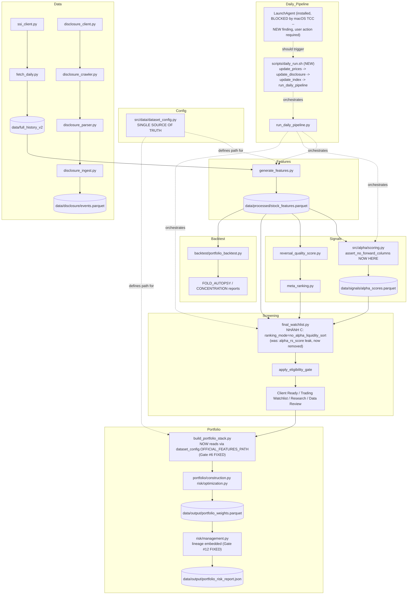

# Architecture and Dependency Map — Round 2 (Phase A/B)

Repo root: `vietnam-quant-research`, branch `main`, audited from worktree
`.claude/worktrees/audit-gates-17-6-12-049aeb`. **Delta from round 1's map**:
`stock-decision-engine/` is **no longer protected/read-only** — the user
explicitly lifted this restriction (`CLAUDE.md` rule 10, 2026-07-17) and
it has since been through its own 3-round audit/fix/prereg cycle. Per
this round's scope (B), it is scored as a **separate appendix**, not
folded into the main 100-point scorecard — see
`sde_appendix_scorecard.md`. The docs tree was also reorganized since
round 1: standalone reports moved from repo root into
`docs/reports/<category>/` (cosmetic, does not change the module map
below).

## Repository structure (excluding data/, caches, venv)

```
vietnam-quant-research/
├── src/                      # reusable modules (module map below, unchanged structure from round 1)
├── scripts/                  # CLI entrypoints; daily_run.sh (NEW since round 1) chains the full daily cycle
├── tests/                    # 39 files, 295 tests (was 32 files / 235 tests at round 1)
├── notebooks/                 # 67 notebooks found this round (organized 00_archive..05_client_report)
├── config/                    # centralized YAML/CSV config
├── data/                      # not audited for content here (see docs/reports/data/DATA_BASELINE.md)
├── docs/reports/<category>/    # (NEW location since round 1) standalone research/design/audit reports,
│                                previously loose at repo root -- data/, disclosure/, scoring/, deploy/,
│                                codebase_audit/ subfolders
├── audit/                     # this audit; round1 files untouched, round2/ is this deliverable set
├── scratch/                   # one-off diagnostic scripts, not production code
├── stock-decision-engine/     # NO LONGER PROTECTED (see above) -- scored separately, appendix
└── *.md                       # gateway docs only now: README.md, CLAUDE.md, PROJECT_STATE.md, PUSH_REVIEW.md
```

## Module map (src/) — unchanged topology from round 1, with the Gate #6 fix applied



**Formerly the single highest-risk architectural coupling, now resolved**:
`scripts/build_portfolio_stack.py` previously read
`data/processed/stock_features.parquet` directly, bypassing the fixed
`data/full_history_v2` dataset. Confirmed this round (direct grep +
independent reproduction, see `critical_findings.md` P0-2/Gate #6): it now
imports and reads via `src/data/dataset_config.py`'s
`OFFICIAL_FEATURES_PATH`, the single source of truth, with an AST-based
regression test (`tests/test_dataset_config.py`) guarding against
reintroduction.

## Duplicated / dead logic found — unchanged from round 1 except where noted

| Location | Duplicate of | Status |
|---|---|---|
| `src/portfolio/risk.py::calculate_risk_contribution` | `src/portfolio/construction.py::portfolio_risk_contributions` | Unchanged — both correct, `risk.py` version still dead code (notebook-only) |
| `equal_weight_allocation`/`inverse_volatility_allocation`/`shrink_covariance` imports in `src/backtest/portfolio_backtest.py` | reimplemented inline in the same file | Unchanged — imported but not called, confirmed by this round's light grep pass; drift risk remains |
| `src/portfolio/returns.py::estimate_expected_returns` + `src/portfolio/optimization.py`'s mean-variance optimizers | — | Unchanged — still entirely unreferenced by any script the daily pipeline runs; still dead code |
| Transaction-cost model | `portfolio_backtest.py` (flat 0.15%) vs. `simulator.py` (flat 0.4%) | Unchanged — confirmed still split via fresh grep this round |
| Sector-cap enforcement | Count-based (`portfolio_backtest.py`) vs. weight-based (`src/portfolio/constraints.py`) | Unchanged — confirmed still dual via fresh grep this round |

**New in round 2**: `stock-decision-engine/src/data.py` was, prior to this
session, an INDEPENDENT third implementation of price-loading logic
(hardcoded its own copy of the `data/processed/clean_daily_ohlcv.parquet`
path, with a fallback to the forbidden legacy raw directory). This has
since been fixed to import from the same `dataset_config.py` single
source of truth the main project uses — see `sde_appendix_scorecard.md`
for detail. `tests/test_dataset_config.py`'s scan scope was extended to
cover `stock-decision-engine/src/` too, so this project no longer has a
second, unguarded copy of the canonical-path logic.

## Notebooks vs. scripts

67 notebooks found this round (vs. 19 "active" at round 1 — the round 1
count likely reflected `notebooks/notebook_inventory.md`'s KEEP
classification specifically, not a raw file count; not reconciled
further this round, out of scope). Not independently re-audited
cell-by-cell this round (would require notebook execution, outside this
round's inventory-only constraint). No evidence of new hardcoded absolute
paths encountered incidentally.

## Configuration sources — unchanged from round 1, plus new pinning

`config/strategy_config.yaml`, `config/vn_market_rules.yaml` (lot size
still declared, still not enforced — confirmed unchanged this round),
`config/vn_market_holidays.csv` (**NEW since round 1**: now includes
empirically-derived lunar Tết dates, confirmed by direct read this
round), `config/core_universe.csv`, `config/excluded_symbols.csv`,
`config/sector_map.csv`. `requirements.txt` (**NEW since round 1**: now
pinned to exact verified-working versions, confirmed by direct read this
round; was open-range `>=` at round 1).

## Protected-folder status (delta from round 1)

`stock-decision-engine/` was protected/read-only at round 1 and confirmed
untouched. **This protection has since been explicitly lifted by the
user** (not by this audit) and the sub-project has been substantially
modified across 3 subsequent rounds (audit-only, data-fix, scoring-prereg)
— see `sde_appendix_scorecard.md` for its own independent audit under the
same 10-category framework, kept separate from the main 100-point score
per this round's explicit instruction (B).
