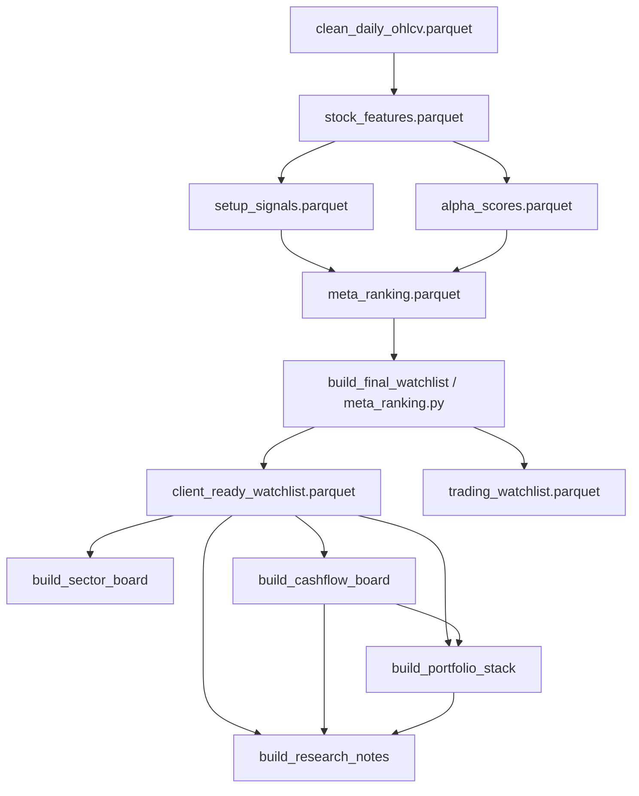

# Screening Logic Audit Report

## 1. Executive Summary
This audit reviews the current candidate screening, scoring, gating, and consistency logic across the entire quant pipeline in `/Users/jamesb/Desktop/vietnam-quant-research`.
The audit reveals critical structural flaws:
- **No hard gates for latest volume or cashflow status:** Symbols with zero volume and `CHECK_REQUIRED` cashflow confirmation (such as **ABB** and **BVB**) are successfully promoted to the `Client Ready` watchlist.
- **Pipeline order issue:** Watchlist generation (`run_meta_ranking.py`) runs *before* the sector board and cashflow board are created. As a result, the watchlists cannot utilize money flow and sector context for screening gates.
- **Portfolio stack leak:** The portfolio weight optimizer and capital allocation plan allocate weights and capital (e.g. 10.61% weight and 100M VND to ABB) to symbols with severe data warnings and cashflow issues.

---

## 2. Pipeline Flow Chart


---

## 3. Top Issues Found
1. **Zero Latest Volume Leak:** **ABB** and **BVB** have `volume = 0` on the latest date, but are included in `client_ready_watchlist`.
2. **CHECK_REQUIRED Promotion:** Both **ABB** and **BVB** are promoted despite `cashflow_data_status = ZERO_VOLUME` and `confirmation_status = CHECK_REQUIRED`.
3. **Downstream Gating Absence:** Money flow confirmation and sector status are calculated downstream of watchlists and do not retroactively filter them.
4. **Portfolio Weight Allocation to CHECK_REQUIRED Tickers:** Portfolio construct allocates substantial capital to warned stocks (e.g. **ABB** allocated 10.61% of NAV).
5. **No Warnings Generated in Watchlist for Zero Volume:** The `warning` column remains empty for zero-volume tickers because `_warnings` only checks rolling 20d average value.
6. **Look-ahead Tickers in Backtest Signals:** `setup_signals.parquet` contains forward compound return horizons which pose data leakage risks if queried directly.
7. **Forced Head(10) slicing:** The screening layers use `head(10)` slicing, promoting symbols that satisfy the loose threshold even if quality is deficient.

---

## 4. Client-Ready Audit Table Summary
Below is the audit status of the current `client_ready_watchlist`:

| Ticker | Close | Volume (Latest) | Cashflow Status | Confirmation | Risk Parity | Allocated NAV | Pass v1 Gate? | Failed Gates |
|---|---|---|---|---|---|---|---|---|
| **SSB** | 16,500 | 3,212,600 | OK | STRONG_CONFIRMED | N/A | N/A | Yes | None |
| **STB** | 73,200 | 3,050,100 | OK | WATCH | N/A | N/A | Yes | None |
| **TCB** | 34,300 | 14,899,400 | OK | STRONG_CONFIRMED | N/A | N/A | Yes | None |
| **VIC** | 217,100 | 1,760,600 | OK | CONFIRMED | N/A | N/A | Yes | None |
| **TPB** | 16,750 | 21,976,800 | OK | STRONG_CONFIRMED | N/A | 32,612,250 VND | Yes | None |
| **LPB** | 53,100 | 1,406,000 | OK | CONFIRMED | N/A | N/A | Yes | None |
| **VPB** | 27,700 | 25,427,300 | OK | STRONG_CONFIRMED | N/A | 32,187,400 VND | Yes | None |
| **VCB** | 63,000 | 4,232,900 | OK | CONFIRMED | N/A | N/A | Yes | None |
| **VIB** | 16,600 | 12,956,800 | OK | STRONG_CONFIRMED | N/A | 34,976,200 VND | Yes | None |
| **HDB** | 26,600 | 20,462,000 | OK | STRONG_CONFIRMED | N/A | 176,411,200 VND | Yes | None |

---

## 5. Most Suspicious Symbols
- **ABB & BVB:** Both have **0** volume on `2026-06-30`, triggered `ZERO_VOLUME` data status and `CHECK_REQUIRED` confirmation, but successfully bypassed all filters. ABB has been allocated **100M VND** of client capital.

---

## 6. Gating Rules Currently Missing
1. **Latest Day Volume Gate:** No check to ensure `volume > 0` on the analysis date.
2. **Cashflow Status Gating:** Cashflow board outputs (`ZERO_VOLUME`, `CHECK_REQUIRED`) do not back-propagate to watchlist filtering.
3. **Data Freshness Hard Gate:** `Stale data` warning does not exclude symbols from candidate pool if they pass raw filters.

---

## 7. Warnings That do Not Affect Output Tiers
- **Missing backtest evidence:** Has a penalty of 20, but the symbol can still exceed the 60.0 score threshold and remain in `Client Ready`.
- **Low liquidity:** Apply 20 penalty but doesn't hard-exclude if `final_score` remains above 60.0.

---

## 8. Proposal for Eligibility Gate v1
We propose introducing a strict multi-layer filter in `src/screening/final_watchlist.py` (or as a post-filter):
1. **Hard Reject Tiers:** Reject any symbol where:
   - Latest volume is 0 or missing.
   - Latest close is <= 0 or missing.
   - Cashflow data status is in `["ZERO_VOLUME", "MISSING_DATA", "CHECK_REQUIRED"]`.
   - Confirmation status is in `["CHECK_REQUIRED", "REJECT"]`.
   - Data age is > 1 day.
2. **Dynamic Watchlist Size:** If only 4 tickers pass these strict requirements, only promote 4 tickers. Move others to `trading_watchlist` or `research_candidates`.

---

## 9. Minimal Proposed Patch
In the next phase, we recommend modifying `_apply_candidate_tiers` in `src/screening/final_watchlist.py` to check for latest day attributes and integrate cashflow confirmation tables dynamically (by loading them if they exist or by adjusting the pipeline order).

---

## 10. Verification Commands
Run the following checks to verify correctness:
```bash
python scripts/audit_screening_logic.py
pytest tests/
python -m src.validation.freshness_check
```
